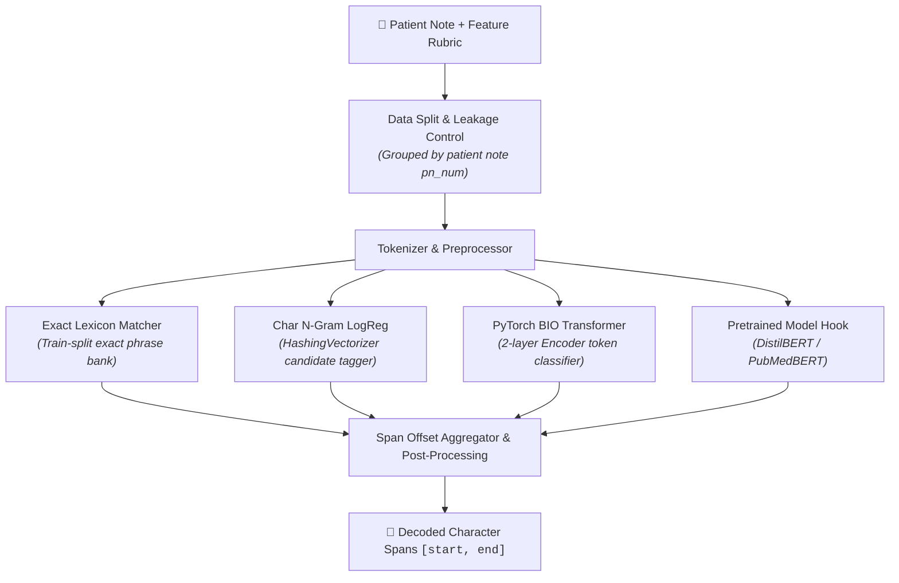

# MedNoteClassifier

**Clinical feature span extraction from USMLE-style patient notes.**

A end-to-end NLP system for the [NBME — Score Clinical Patient Notes](https://www.kaggle.com/competitions/nbme-score-clinical-patient-notes/data) dataset. The models extract exact character-level spans corresponding to rubric clinical features (e.g., *heart pounding*, *family history of MI*) from standardized patient exam notes.

> **Notice:** This repository is intended strictly for research and educational purposes. It is not a medical device and must not be used for diagnosis, clinical decision support, or direct patient care.

---

## Overview & Problem Statement

In clinical documentation, relevant findings are often embedded within unstructured narratives. Automatic span extraction identifies exact text offsets expressing clinical rubric concepts rather than assigning broad document-level classification tags. 

The **NBME (National Board of Medical Examiners)** dataset provides physician-annotated character spans across clinical notes recorded during USMLE® Step 2 Clinical Skills exam encounters.

### Task Specification

Given a patient history note (`pn_history`) and a target rubric concept (`feature_text`), predict all character offsets `[start, end]` in the note that express the concept.

- **Primary Metric:** Character-level micro-F1 score over predicted vs. gold-standard character offsets.
- **Empty Annotations:** Empty annotation lists `annotation=[]` indicate true negatives (the rubric feature is absent from the note).

---

## Dataset Details

| File | Shape | Content / Role |
| --- | --- | --- |
| `patient_notes.csv` | 42,146 × 3 | Clinical notes (`pn_num`, `case_num`, `pn_history`) |
| `features.csv` | 143 × 3 | Case-specific rubric concepts (`feature_num`, `case_num`, `feature_text`) |
| `train.csv` | 14,300 × 6 | Annotated note-feature pairs (`id`, `case_num`, `pn_num`, `feature_num`, `annotation`, `location`) |
| `test.csv` | 5 × 4 | Test set submission format stub |
| `sample_submission.csv` | 5 × 2 | Kaggle submission format sample |

### Data Splits & Leakage Prevention

- **Grouping Key:** `pn_num` (patient note ID).
- **Split Ratio:** 80% Train (800 notes / 11,440 rows), 10% Validation (100 notes / 1,430 rows), 10% Test (100 notes / 1,430 rows).
- **Stratification:** Stratified by `case_num` across 10 clinical cases (Random Seed: `42`).
- **Leakage Control:** All annotations from a single note are restricted to exactly one split.

---

## Model Architecture & Pipeline



1. **Exact Lexicon Matcher:** Extracts phrase patterns compiled exclusively from the training split. Filters out short 1-character matches and enforces word boundaries.
2. **Hybrid Classifier:** Combines the exact lexicon matcher with a `HashingVectorizer` character n-gram logistic regression model (`models/baseline/hybrid_baseline.joblib`).
3. **Transformer Token Classifier:** A 2-layer `TransformerEncoder` (`d_model=96`, 4 heads, FFN=192, max sequence length 160) trained from scratch with BIO (Begin/Inside/Outside) tagging (`models/transformer/span_transformer.pt`).
4. **Pretrained Transformer Hook:** Extensible interface (`train_distilbert`) ready for fine-tuning `DistilBERT` or `PubMedBERT` on GPU hardware.

---

## Benchmark Results

Evaluated on the held-out test split (100 notes, 1,430 note-feature pairs, seed 42) using exact character-level micro-F1:

| Model | Precision | Recall | Micro-F1 | Exact Span Match |
| --- | ---: | ---: | ---: | ---: |
| Empty (Majority Baseline) | 1.0000 | 0.0226 | 0.0443 | 0.3140 |
| **Lexicon Matcher** | **0.5352** | 0.5571 | **0.5459** | **0.3727** |
| Hybrid (Lexicon + LogReg) | 0.5062 | **0.5831** | 0.5420 | 0.3420 |
| Lightweight Transformer | 0.0488 | 0.5943 | 0.0901 | 0.0000 |

### Key Observations
- The **Train-Set Lexicon** achieved the strongest baseline performance (F1: `0.5459`). Word-boundary constraints and filtering 1-character spans significantly improved precision.
- **Logistic Regression** improved recall (+0.026) but introduced slight noise, resulting in an F1 of `0.5420`.
- The **Lightweight Transformer** trained from scratch serves as an architectural proof-of-concept for BIO sequence tagging; full clinical accuracy requires pretrained encoders (e.g., PubMedBERT).

---

## Installation & Setup

### Environment Setup

Python 3.10+ is recommended.

```bash
cd MedNoteClassifier
python -m venv .venv
source .venv/bin/activate  # On Windows: .venv\Scripts\activate
pip install -r requirements.txt
```

### Data Placement

Download the dataset CSV files from the [Kaggle Competition Page](https://www.kaggle.com/competitions/nbme-score-clinical-patient-notes/data) and place them into `data/raw/`:

```
data/raw/
├── train.csv
├── patient_notes.csv
├── features.csv
├── test.csv
└── sample_submission.csv
```

---

## Execution Guide

### 1. Run Pipeline (EDA, Training & Evaluation)

```bash
python -m src.run_pipeline
```
This executes data loading, exploratory data analysis, note-grouped split generation, baseline training, evaluation, and saves artifacts under `reports/` and `models/`.

### 2. Run Inference CLI

Predict clinical features for custom text inputs:

```bash
python -m src.predict \
  --text "17-year-old male presenting with heart pounding for two months and family history of MI." \
  --case 0 \
  --model hybrid
```

Output format (JSON):
```json
{
  "model": "hybrid",
  "case_num": 0,
  "entities": [
    {
      "text": "heart pounding",
      "type": "RUBRIC_FEATURE",
      "start": 32,
      "end": 46
    }
  ]
}
```

### 3. Run Test Suite

```bash
python -m pytest tests -q
```

### 4. Interactive Web Interface (Optional)

Launch the Streamlit web app:

```bash
python -m streamlit run app/predict.py
```

---

## Project Structure

```
MedNoteClassifier/
├── app/
│   └── predict.py              # Streamlit demo application
├── data/
│   ├── raw/                    # Raw Kaggle CSV files (git-ignored)
│   └── processed/              # Processed parquets and split mappings
├── models/
│   ├── baseline/               # Saved joblib baseline checkpoints
│   └── transformer/            # PyTorch transformer checkpoints
├── notebooks/                  # Jupyter notebooks for EDA & experimentation
├── reports/
│   ├── figures/                # EDA & evaluation charts
│   └── metrics/                # Metric evaluation JSON summaries
├── src/
│   ├── config.py               # Path definitions & hyperparameter config
│   ├── data_loader.py          # Data ingestion utilities
│   ├── dataset.py              # PyTorch dataset & BIO tag encoding
│   ├── evaluate.py             # NBME micro-F1 scoring implementation
│   ├── predict.py              # Inference API & CLI entrypoint
│   ├── preprocessing.py        # Text tokenization & offset validation
│   ├── run_pipeline.py         # Main execution pipeline runner
│   └── train_transformer.py    # Transformer training logic
├── tests/                      # Pytest unit & integration tests
├── LICENSE                     # MIT License file
├── README.md                   # Project documentation
└── requirements.txt            # Python dependencies
```

---

## Security, Privacy & Safety Guidelines

- **Protected Health Information (PHI):** Do not input real patient health records into this application or commit private clinical notes to repository tracking.
- **De-identification:** The NBME dataset contains synthetic/de-identified examination artifacts. Ensure compliance with Kaggle competition terms regarding dataset distribution.
- **Clinical Safety Disclaimer:** Span extraction algorithms can misclassify negated assertions (e.g., *"No chest pain"* vs. *"Chest pain"*). Model output must never be used for medical triage, billing, or direct care.

---

## Future Improvements

1. **PubMedBERT Fine-tuning:** Fine-tune `microsoft/BiomedNLP-PubMedBERT-base-uncased-abstract` using Hugging Face `transformers`.
2. **Conditional Random Fields (CRF):** Add a linear-chain CRF layer on token classification logits to enforce valid BIO transition structures.
3. **Clinical Spelling Normalization:** Apply train-set fitted edit-distance spell-checking for USMLE abbreviations and common exam typos.

---

## License

This repository is licensed under the **MIT License**. Dataset files are subject to the original NBME / Kaggle competition terms of use.
