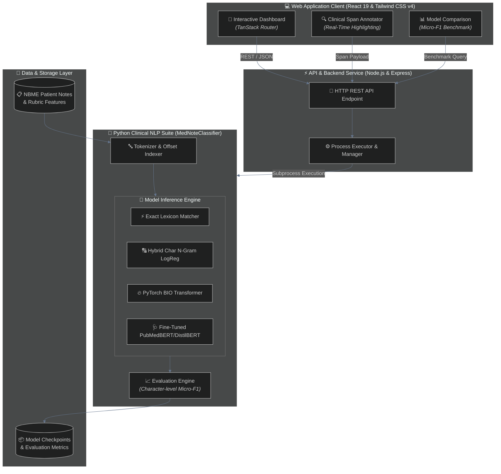
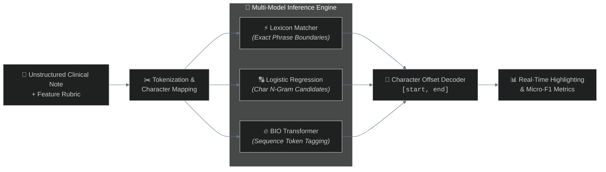

# 🩺 MedNoteClassifier Workspace

> **Clinical Feature Span Extraction Suite & Interactive Web Application**

[](https://nodejs.org/)
[](https://www.python.org/)
[](https://react.dev/)
[](https://vitejs.dev/)
[](https://tailwindcss.com/)
[](MedNoteClassifier/LICENSE)

---

## 📌 Overview

**MedNoteClassifier** is a full-stack clinical NLP solution designed for automated span extraction on the **NBME® — Score Clinical Patient Notes** dataset (USMLE® Step 2 Clinical Skills). The system identifies exact character offsets `[start, end]` in unstructured patient notes corresponding to standardized rubric concepts (e.g., *"heart pounding"*, *"family history of MI"*).

The workspace bundles a high-performance **Python ML Package** ([`MedNoteClassifier/`](file:///c:/Users/athar/Desktop/Projects/MedNoteClassifier/MedNoteClassifier/README.md)) with a modern **React 19 & Vite Web Application** for interactive annotation, real-time prediction visualization, and model performance benchmarking.

---

## 📐 Architecture & Workflow

### 1. System Architecture



---

### 2. Clinical Span Extraction Pipeline



---

## 🗂 Workspace Structure

```
.
├── MedNoteClassifier/       # Python Machine Learning package (NLP Models, Datasets & Evaluation)
│   ├── app/                 # Streamlit standalone demo app
│   ├── data/                # Dataset directory (raw Kaggle CSVs & processed files)
│   ├── models/              # Saved model checkpoints (Lexicon, Hybrid LogReg, PyTorch Transformer)
│   ├── reports/             # EDA charts, evaluation metrics, and error analysis JSONs
│   ├── src/                 # ML source modules (pipeline, preprocessing, model architectures)
│   ├── tests/               # Pytest suite for ML modules
│   └── README.md            # Comprehensive ML package documentation
├── src/                     # React 19 & Vite web application frontend
├── server/                  # Backend application services & API routes
├── scripts/                 # App utility & environment startup scripts
├── startup.sh               # Unix/Linux background startup script
├── startup.bat              # Windows Command Prompt background startup script
├── startup.ps1              # Windows PowerShell background startup script
├── package.json             # Web application Node.js dependencies & scripts
└── README.md                # Root project documentation
```

---

## 🛠 Sub-Projects & Components

### 1. Clinical NLP Machine Learning Module ([`MedNoteClassifier/`](file:///c:/Users/athar/Desktop/Projects/MedNoteClassifier/MedNoteClassifier/README.md))
Located in [`MedNoteClassifier/`](file:///c:/Users/athar/Desktop/Projects/MedNoteClassifier/MedNoteClassifier/README.md).
- **Core Task:** Extracts character-level clinical rubric features from USMLE-style patient notes.
- **Model Implementations:**
  - **Exact Lexicon Matcher:** Fast exact phrase match with strict word-boundary enforcement.
  - **Hybrid Logistic Regression:** `HashingVectorizer` character n-gram classifier combined with phrase matching.
  - **PyTorch BIO Transformer:** Custom 2-layer TransformerEncoder tagging sequence tokens with BIO labels.
  - **DistilBERT / PubMedBERT Hook:** Extensible trainer for fine-tuning transformer models on medical text.
- For complete setup instructions and model benchmarks, see [`MedNoteClassifier/README.md`](file:///c:/Users/athar/Desktop/Projects/MedNoteClassifier/MedNoteClassifier/README.md).

### 2. Live Web Dashboard Application ([`src/`](file:///c:/Users/athar/Desktop/Projects/MedNoteClassifier/src))
Powered by React 19, Vite, TanStack Router/Start, and Tailwind CSS v4.
- Provides interactive visual clinical note annotation, real-time span highlighting, and model prediction comparison.

---

## 🚀 Getting Started

### Prerequisites

| Tech | Version Required | Purpose |
| --- | --- | --- |
| **Node.js** | `v18+` or `v20+` | Web dashboard & API services |
| **Python** | `v3.10+` | NLP ML models & pipeline |

---

### Quickstart Guide

#### 1. Web Application (React + Node.js)

Install Node.js dependencies and launch the dev server:

```bash
# Install NPM dependencies
npm install

# Start dev server on http://localhost:8080
npm run dev
```

#### 2. Machine Learning Pipeline (Python)

Set up a Python virtual environment and run the pipeline:

```powershell
# 1. Navigate to the ML project directory
cd MedNoteClassifier

# 2. Re-create virtual environment if migrating directories (optional)
# Remove-Item -Recurse -Force .venv

# 3. Create virtual environment
python -m venv .venv

# 4. Activate virtual environment
# On Windows (PowerShell):
.\.venv\Scripts\Activate.ps1
# On Windows (CMD):
.\.venv\Scripts\activate.bat
# On Linux/macOS:
source .venv/bin/activate

# 5. Install dependencies
python -m pip install -r requirements.txt

# 6. Run full ML pipeline (EDA, Training, Evaluation)
python -m src.run_pipeline

# 7. (Optional) Run Python test suite
python -m pytest tests -q

# 8. (Optional) Run interactive Streamlit app
python -m streamlit run app/predict.py
```

---

## ⚡ Convenience Startup Scripts

To launch the web preview server automatically:

- **Linux / macOS:** `./startup.sh`
- **Windows Command Prompt:** `startup.bat`
- **Windows PowerShell:** `.\startup.ps1`

> [!NOTE]
> These scripts verify whether port `8080` is active and start `npm run dev` in the background if needed.

---

## 📜 Available NPM Scripts

| Command | Description |
| --- | --- |
| `npm run dev` | Launch Vite dev server on port `8080` |
| `npm run build` | Build production bundle and run database migrations |
| `npm run typecheck` | Run TypeScript type checking |
| `npm run test` | Run application unit and integration tests |
| `npm run lint` | Run ESLint across codebase |
| `npm run format` | Format files with Prettier |

---

## 🔄 Continuous Integration (CI)

GitHub Actions workflows are configured under `.github/workflows/ci.yml` for automated testing and validation on `push` and `pull_request`.

---

## 📄 License

This project is licensed under the MIT License. See [`LICENSE`](file:///c:/Users/athar/Desktop/Projects/MedNoteClassifier/MedNoteClassifier/LICENSE) inside `MedNoteClassifier/` for details.
